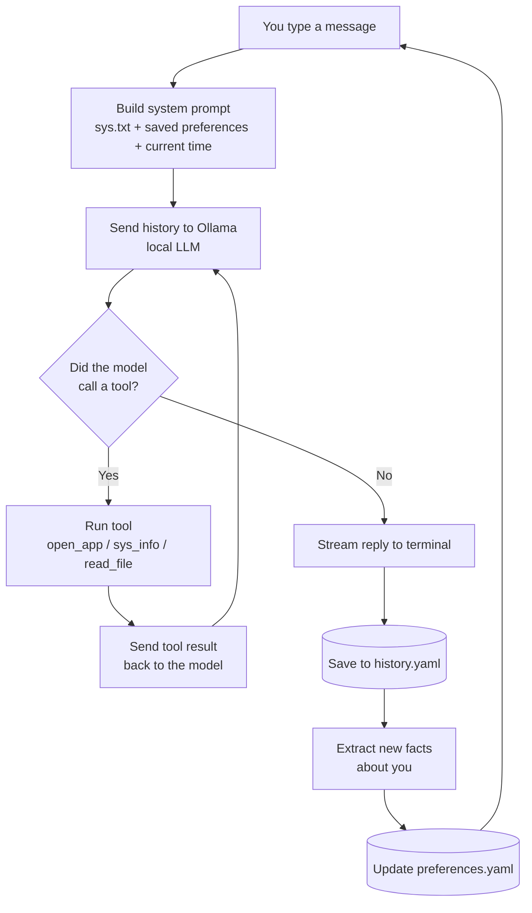
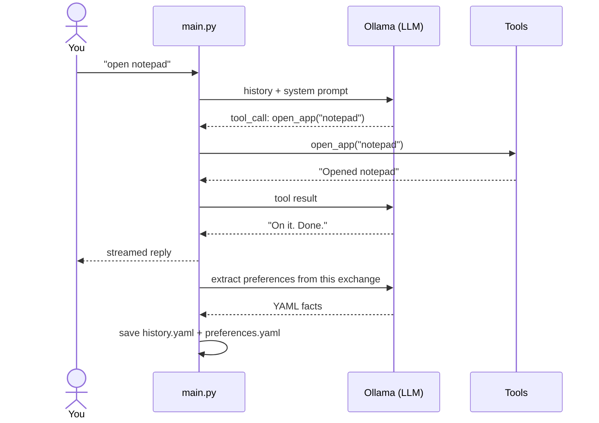

# Jarvis: a local AI assistant

A command-line AI assistant that runs **fully offline** on your own PC using [Ollama](https://ollama.com). It chats in a casual personality, remembers things about you, and can use tools like opening apps and reading files.

No API keys. No cloud. Your data stays on your machine.

> **Don't like the name "Jarvis"?** Call it whatever you want. See [Rename your assistant](#rename-your-assistant).

## Features

- **Local LLM** via Ollama (you choose the model)
- **Streaming replies**, printed token by token
- **Tool calling**: open apps, read files, get system info
- **Persistent chat history** saved to `history.yaml`
- **Long-term memory**: the model extracts facts about you into `preferences.yaml`
- **Customisable personality** through `sys.txt`

## Two scripts: start simple, then upgrade

| File | Use it for |
|------|-----------|
| `testllm.py` | **Start here.** A tiny chat script (about 35 lines) with no tools and no memory. Good for checking that Ollama and your model work, and for learning how the chat loop is built. |
| `main.py` | **The full assistant.** Tools, saved history and long-term memory. Move to this once `testllm.py` works. |

## How it works (`main.py`)



### One chat turn



## Tools

| Tool | What it does |
|------|--------------|
| `open_app(name)` | Opens an app on your PC (Start Menu shortcuts + built-ins like notepad, calculator) |
| `sys_info()` | Returns OS, CPU and RAM info |
| `read_file(path)` | Reads a text file and returns its content |

## Project structure

```
llm/
├── main.py            # Full assistant: chat loop, tools, memory
├── testllm.py         # Beginner chat script (start here)
├── sys.txt            # System prompt (personality and rules)
├── preferences.yaml   # Long-term memory (auto-generated)
├── history.yaml       # Chat history (auto-generated)
└── requirements.txt   # Python dependencies
```

## Setup

**Requirements:** Python 3.10+ and Ollama. `main.py` is built for **Windows** (it opens apps from the Start Menu). `testllm.py` works on any OS.

### Step 1: Install Ollama

1. Go to **[ollama.com/download](https://ollama.com/download)**.
2. Pick your OS and follow the instructions on that page:
   - **Windows:** download the installer (`OllamaSetup.exe`) and run it.
   - **macOS:** download the app and move it to Applications.
   - **Linux:** run the install command shown on the page.
3. Open a **new** terminal and check it worked:

```bash
ollama --version
```

Ollama runs in the background after install, so there's nothing else to start.

### Step 2: Download a model

Browse models at **[ollama.com/library](https://ollama.com/library)**, then pull one with `ollama pull <model-name>`. For example, a small model that runs on modest PCs:

```bash
ollama pull qwen2.5:3b
```

See which models you have installed:

```bash
ollama list
```

Other handy commands:

```bash
ollama run qwen2.5:3b    # chat with a model directly in the terminal
ollama rm qwen2.5:3b     # delete a model to free up disk space
```

### Step 3: Get the code

```bash
git clone https://github.com/007Raghu/llm.git
cd llm
pip install -r requirements.txt
```

### Step 4: Set your model in the code

Open `main.py` (and `testllm.py`) and find this line near the top:

```python
model = ""
```

Put the exact model name from `ollama list` between the quotes:

```python
model = "qwen2.5:3b"
```

> **Tip:** for `main.py`, pick a model that supports tools (for example `qwen2.5:3b` or `llama3.2:3b`). Tiny models can be unreliable at tool calling, and some give a "does not support tools" error.

### Step 5: Run it

Start with the beginner script:

```bash
python testllm.py
```

When that works, run the full assistant:

```bash
python main.py
```

Type `exit`, `quit` or `bye` to stop.

## Rename your assistant

The assistant is called **Jarvis** by default. To use your own name, change it in these places:

| File | What to change |
|------|----------------|
| `sys.txt` | The first line `You are Jarvis...` and the `Jarvis:` lines in the EXAMPLES section |
| `main.py` | The `Jarvis: ` text in the `print(...)` line before the reply |
| `testllm.py` | The `You are Jarvis...` system prompt and the `"Jarvis: "` print |

Tip: use your editor's **Find and Replace** (Ctrl+H in VS Code) to swap `Jarvis` for your name in all three files at once.

## Example

```
You: open calculator
Jarvis: On it.
[tool: open_app -> Opened calculator]
Jarvis: Done. Try not to divide by zero, bro.
```

## Customising

- **Personality:** edit `sys.txt`. Change the tone, rules and examples however you like.
- **Model:** change the `model` variable at the top of `main.py`. Use any name shown by `ollama list`.
- **Add a tool:** write a Python function with a docstring and type hints, then add it to the `TOOLS` tuple in `main.py`.

## Tech stack

Python · Ollama · PyYAML · psutil · colorama

## Author

Built by **Raghu** *:)*.
